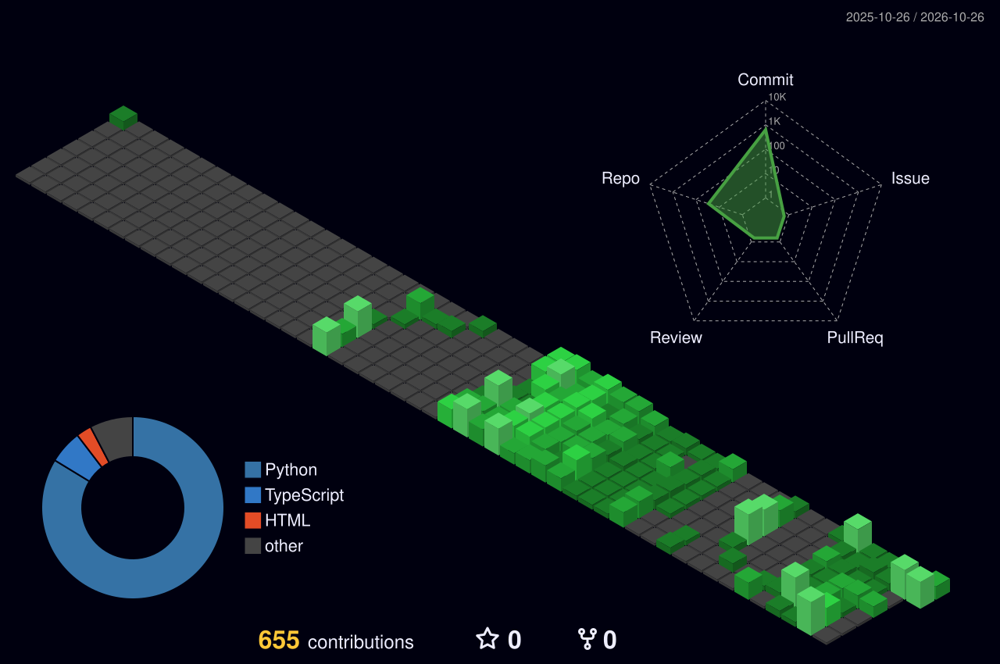

 <h1 align="center">
  
</h1>

  

---

## About Me

- 3rd-Year B.Tech student in Electronics & Computer Engineering at Vignan Institute of Information Technology, Duvvada
- Python Full-Stack Developer focused on backend development
- Building projects using Django, FastAPI, and REST APIs
- Exploring AI, automation, and machine learning integrations
- Practicing Data Structures and Algorithms
- Interested in backend engineering, system design, and real-world projects

  
  
  

---

## Programming Languages

---

## Frontend Development

---

## Backend Development

---

## Databases & Caching

---

## AI / Data Science

---

## DevOps

---

## Tools

---

## Computer Science Fundamentals

---

## GitHub Analytics

  
  

---

## Most Used Languages

  

---

## Contribution Calendar

  

---

## Productivity Stats

  

  

---

  <b>Keep Learning. Keep Building. Keep Growing. 🚀</b>
   
  Thanks for visiting my GitHub profile!

